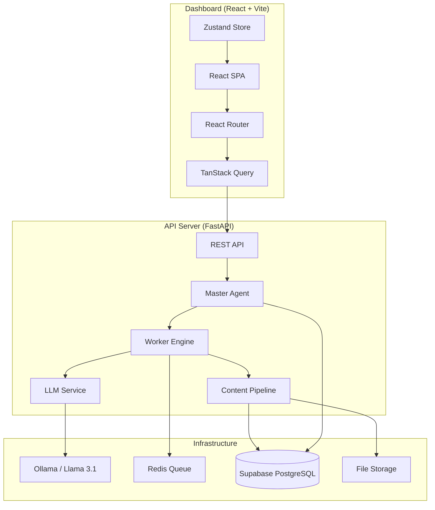
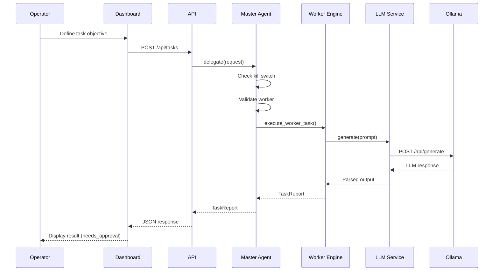

# Architecture

## System Overview

HIVE is an autonomous AI media network built as a modular system with clear separation of concerns.

## Component Responsibilities

### Master Agent
- Validates task assignments
- Evaluates worker availability and performance
- Delegates tasks to the appropriate worker
- Monitors execution and handles failures
- Enforces the global kill switch

### Worker Engine
- Reusable execution engine — one implementation, many workers
- Workers are configured via database records, not code
- Each worker has isolated memory and brand identity
- Executes through a LangGraph pipeline with typed state transitions

### LLM Service
- Wraps Ollama API with concurrency control (semaphore)
- Provides model abstraction for future multi-model support
- Handles timeouts, retries, and error classification
- Health checking for model availability

### Content Pipeline
- Research → Topic Selection → Strategy → Script → Creative → Quality Check → Approval → Publish
- Each stage is a LangGraph node with typed inputs/outputs
- Stages can be skipped or repeated based on workflow configuration

### Platform Adapters
- Abstract interface for social media publishing
- Each platform (Instagram, YouTube, Facebook, X) has its own adapter
- Manual publishing fallback when API access is unavailable
- Draft → Approval → Scheduled → Published → Analytics lifecycle

## Data Flow

## Security Architecture

- All endpoints will be protected by Supabase Auth (Milestone 3)
- Row Level Security on all database tables
- Global kill switch stops all autonomous operations
- Worker-level pause/resume controls
- Credential isolation between workers
- Audit logging for all state changes
- Rate limiting on API endpoints

