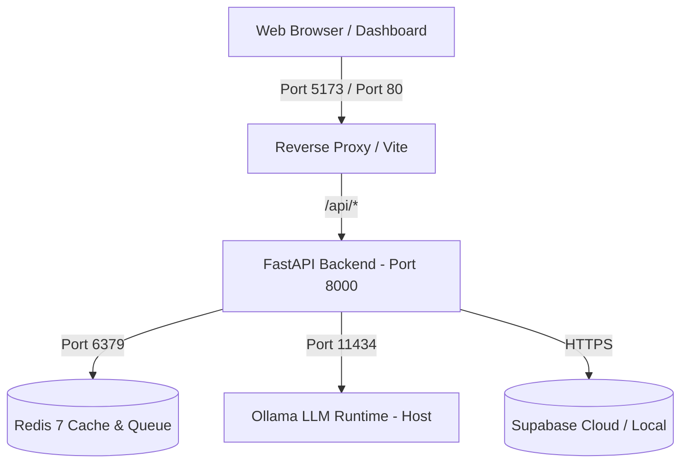

# Deployment Guide

## Architecture Deployment Model

HIVE is designed for local-first deployment with containerized services.



## Local Production/Staging Setup

### 1. Host Requirements
- Windows 10/11, macOS, or Linux
- Docker Engine & Docker Compose
- Ollama with `llama3.1:latest`
- 16GB+ RAM recommended for local 8B LLM inference

### 2. Environment Configuration
Copy `.env.example` to `.env`:
```bash
cp .env.example .env
```
Ensure `OLLAMA_URL` points to `http://host.docker.internal:11434` for Docker containers on Windows/macOS, or host IP on Linux.
Configure Supabase connectivity with your project credentials:
```bash
SUPABASE_URL="https://<your-project-ref>.supabase.co"
SUPABASE_SERVICE_ROLE_KEY="<your-service-role-key>"
VITE_SUPABASE_URL="https://<your-project-ref>.supabase.co"
VITE_SUPABASE_PUBLISHABLE_KEY="<your-publishable-key>"
```

### 3. Frontend Production Build & Deployment
For standalone production hosting of the UI dashboard:
```bash
cd frontend
npm install
npm run build
```
The compiled SPA is generated in `frontend/dist/` and can be served via Nginx, Cloudflare Pages, Vercel, or AWS S3/CloudFront.

### 4. Docker Service Launch
```bash
docker compose up -d --build
```

Verify services:
```bash
docker compose ps
docker compose logs -f api
```

### 5. Health Checks & System Telemetry
- Backend Liveness API: `GET http://localhost:8000/api/health`
- Real-Time System Telemetry: `GET http://localhost:8000/api/system/metrics`
- Emergency Kill Switch Status: `GET http://localhost:8000/api/system/metrics` (inspect `kill_switch_active`)
- Emergency Halt Dispatch: `POST http://localhost:8000/api/system/kill-switch?enabled=true`
- Frontend Dashboard: `http://localhost:5173`
- Redis: `docker compose exec redis redis-cli ping` (PONG)

## CI / Automated Deployment Considerations

- Container images built with multi-stage Dockerfiles
- Frontend assets compiled via Vite to static bundles (`/dist`)
- Secrets managed via environment injection or secret manager; never checked into version control

