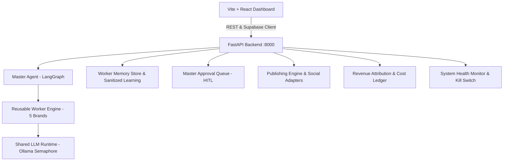

# HIVE — Autonomous AI Media Network

A production-grade, modular AI media network coordinating 5 niche media brands through a central Master Agent, shared Ollama LLM runtime (`llama3.1`), Supabase PostgreSQL persistence, official platform adapters, and an amber/charcoal dark-mode operations dashboard.

## System Architecture



## Features & Capabilities

- **Master Agent Orchestration**: 5-node LangGraph state machine (`kill_switch` → `prioritize_and_plan` → `validate_assignment` → `delegate_to_worker` → `editorial_evaluator`).
- **5 Autonomous Brand Workers**: Tech & AI (`tech`), Business & Startups (`biz`), Entertainment (`culture`), Education & Science (`facts`), Lifestyle & Wellness (`lifestyle`).
- **Multi-Format Content Studio**: Automated niche trend research, short video scripts, Twitter/X threads, carousel slides, and Midjourney/Flux asset generation prompts.
- **Mandatory Human-in-the-Loop (HITL)**: Full approval queue workflow for editorial review, revisions, and publication sign-off.
- **Official Platform Distribution**: Zero-scraping policy with authorized adapters for Instagram, YouTube Shorts, X/Twitter, and Facebook Pages, plus universal sanitized manual dispatch fallback.
- **Revenue Engine**: First-class tracking of affiliate commissions, sponsorships, lead conversion, and platform ad revenue against LLM and asset production costs.
- **Production Hardening**: Global emergency kill-switch circuit breaker, real-time telemetry diagnostics, Supabase PostgreSQL schema with RLS, and `@supabase/supabase-js` client integration.

## Requirements
- Windows 10/11, macOS, or Linux
- Docker Desktop (with Compose)
- Ollama with `llama3.1` model (`ollama pull llama3.1`)
- Node.js 20+

## 1. Start Ollama
```powershell
ollama serve
# Ensure llama3.1 is pulled
ollama pull llama3.1
```

## 2. Start Backend & Infrastructure
```powershell
docker compose up -d --build
```
- API root: `http://localhost:8000`
- Interactive OpenAPI Docs: `http://localhost:8000/docs`
- Health check: `http://localhost:8000/api/health`
- Telemetry: `http://localhost:8000/api/system/metrics`

## 3. Start Frontend Dashboard
```powershell
cd frontend
npm install
npm run dev
```
Dashboard: `http://localhost:5173`

To build the frontend for production:
```powershell
cd frontend
npm run build
```

## 4. Run Automated Tests
```powershell
$env:PYTHONPATH="E:\HIVE\backend"
python -m pytest backend/tests/ -v
```

## Operational Safety Principles
- **Global Kill Switch**: Immediate emergency pause via UI or `POST /api/system/kill-switch?enabled=true`.
- **Approval Gate**: All external publishing and commercial claims mandate human operator review.
- **Memory Isolation**: Individual worker brand histories and credentials remain strictly isolated.
"# HIVE" 
